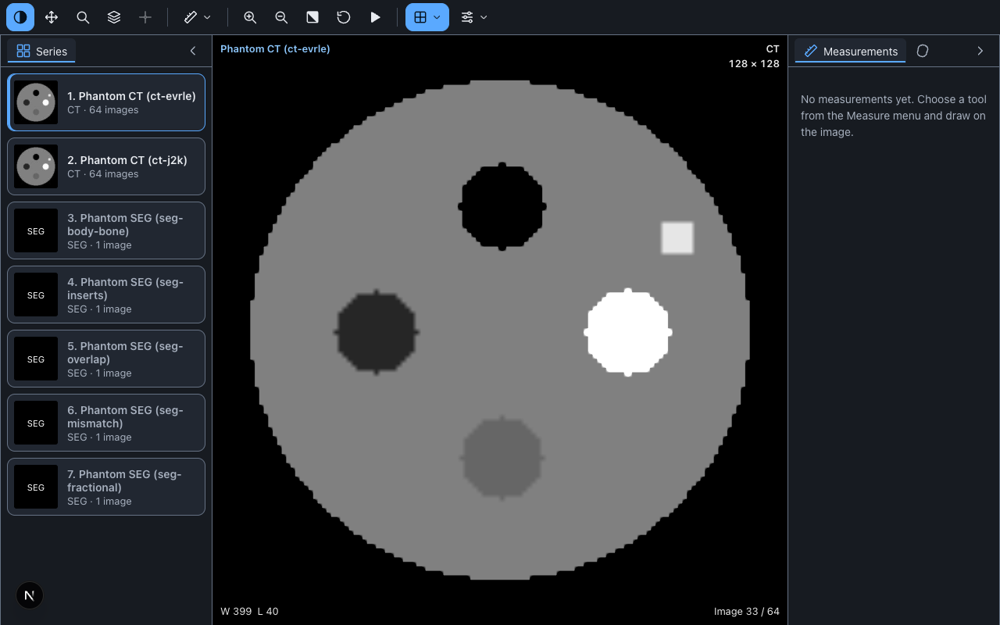

# Tutorial: add a DICOM viewer to a Next.js app

In about ten minutes you will have a Next.js page that shows a CT study, with a toolbar, a series list, and measurement tools. You will use the packages from npm and the synthetic phantom study from this repository, so you need no real patient data.



You need Node.js 24 and npm. The viewer needs no bundler setup and no change to `next.config`.

> The phantom is synthetic. The viewer is not a medical device and is not for diagnosis (see the [README](../../README.md)).

## 1. Create the app

```bash
npx create-next-app@latest viewer-demo --ts --app
cd viewer-demo
```

Accept the defaults. This tutorial was checked with Next.js 16 and React 19.

## 2. Install the viewer

```bash
npm install @01x/dicom-viewer-core @01x/dicom-viewer-react
```

`@01x/dicom-viewer-core` is the viewer itself. `@01x/dicom-viewer-react` is the component that puts it on a page.

## 3. Add the viewer component

Create `app/viewer.tsx`:

```tsx
'use client';

import { createDicomWebDataSource, type ViewerOptions } from '@01x/dicom-viewer-core';
import { DicomViewer } from '@01x/dicom-viewer-react';
import type { JSX } from 'react';

// Keep this object outside the component. A new object on every render restarts the viewer.
const options: ViewerOptions = {
  dataSource: createDicomWebDataSource({ wadoRoot: 'http://127.0.0.1:8042' }),
};

const STUDY_UID = 'paste-the-study-uid-here';

export function Viewer(): JSX.Element {
  return <DicomViewer options={options} studyInstanceUID={STUDY_UID} />;
}
```

Two things to know:

- A **data source** says where the images come from. Here it is a DICOMweb server (the standard web API that image servers speak) at `wadoRoot`.
- A **study UID** says which study to open. You will get one in step 5.

## 4. Show it on the page

Replace `app/page.tsx`:

```tsx
import type { JSX } from 'react';
import { Viewer } from './viewer';

export default function Page(): JSX.Element {
  return (
    <div style={{ height: '100vh' }}>
      <Viewer />
    </div>
  );
}
```

The viewer fills its parent, so the parent needs a height. Without one you see a blank box.

## 5. Start a server with test images

The repository has a small DICOMweb server that serves the phantom. In a second terminal:

```bash
git clone https://github.com/01x-in/dicom-viewer.git
cd dicom-viewer/tools/dicomweb-mock
npm install
node src/cli.ts --mode open
```

It prints a line like this:

```text
dicomweb-mock (open) listening on http://127.0.0.1:8042
study: 2.25.322712317832071638901734109835358565448
```

Copy the study UID into `STUDY_UID` in `app/viewer.tsx`. Leave the server running.

`--mode open` serves everything. Without it, the server acts like a locked-down proxy that refuses some requests. That mode is for testing the viewer against such servers.

## 6. Run it

```bash
npm run dev
```

Open <http://localhost:3000>. After a moment you see the phantom CT. Try these:

- Scroll the mouse wheel over the image to move through the 64 slices.
- Drag to change the window and level (the brightness and contrast of a CT image).
- Pick a tool from the Measure menu and draw on the image. The measurement appears in the panel on the right.
- Click a series in the list on the left to open it.

The series called "SEG" are DICOM SEG objects: coloured overlays that mark regions of the CT. The [measurements and segmentations guide](measurements-and-segmentations.md) shows how to load them.

## 7. Make it yours

The component takes props for the look and the panels. Change the return of `Viewer` to this:

```tsx
return (
  <DicomViewer
    options={options}
    studyInstanceUID={STUDY_UID}
    theme="light"
    palette="navy"
    hideSegmentationsPanel
    onError={(error) => console.error('viewer error:', error.message)}
  />
);
```

- `theme` is `dark` or `light`. `palette` is `default`, `navy`, or `graphite`.
- `hideSegmentationsPanel` removes the Segments panel. There are matching props for the series and measurement panels.
- `onError` receives the `Error` when something fails, so you can send it to your own logging. See the [observability guide](observability.md).

Every colour is also a `--dv-color-*` CSS property, so the viewer can take the colours of your page.

## 8. Use your own server

Change the data source. A server that needs sign-in gets a token from your code on every request:

```ts
const dataSource = createDicomWebDataSource({
  wadoRoot: 'https://pacs.example.org/dicom-web',
  getRequestHeaders: () => ({ Authorization: `Bearer ${session.token}` }),
  onUnauthorized: async () => session.refresh(),
});
```

The server must also allow your page's origin with CORS (the browser rule that decides which sites may read a server's answers). The viewer does not store the token and never puts it in a link.

**You** decide who may see which study. The package has no login of its own. Read [what the package does, and what you do](../../README.md#security-what-the-package-does-and-what-you-do) before you put real data behind it.

## If something goes wrong

| What you see | Likely cause |
|---|---|
| A blank box | The parent has no height (step 4) |
| The viewer restarts on every render | `options` is created inside the component (step 3) |
| `The DICOMweb request failed: Failed to fetch` | The server is not running, or it does not allow `http://localhost:3000` with CORS |
| `The DICOMweb server answered HTTP 404 ...` | `STUDY_UID` is not the one the server printed |

The viewer reports these to `onError` (step 7), so add that prop while you build.

[Installing in a framework](installing.md) lists more causes, including strict Content Security Policy settings. Chromium is the tested browser. The examples also pass in WebKit, and Firefox is not tested yet.

## Where to go next

- [Data sources](data-sources.md): tokens, retries, servers that limit what they hand out, and local files.
- [Measurements and segmentations](measurements-and-segmentations.md): draw, export, and import measurements from code, and load SEG overlays.
- [examples/next-app](../../examples/next-app): a complete Next.js example, tested with both Turbopack and webpack.
- The same viewer runs in Vue and Nuxt (`@01x/dicom-viewer-vue`) and in plain HTML (`@01x/dicom-viewer-elements`). See the [README](../../README.md#using-it).
